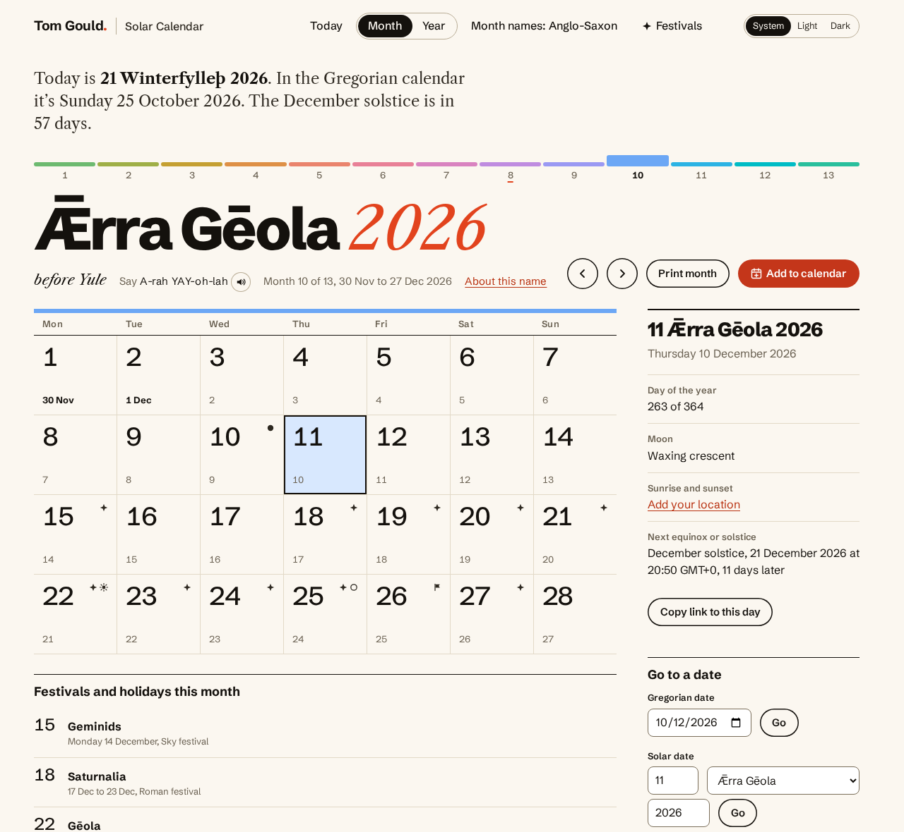
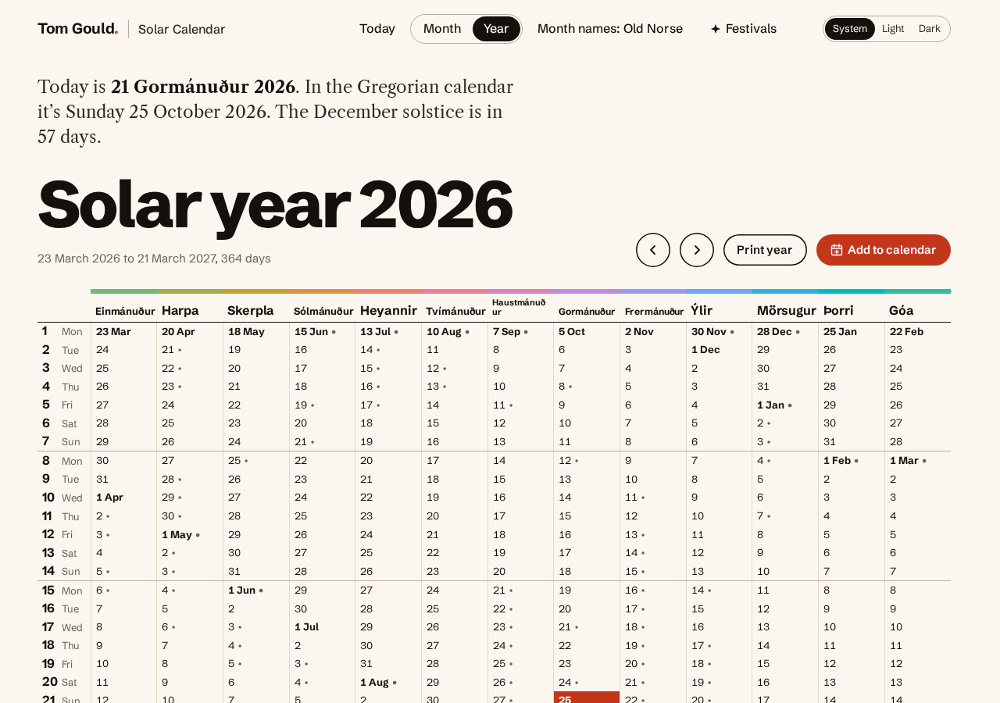
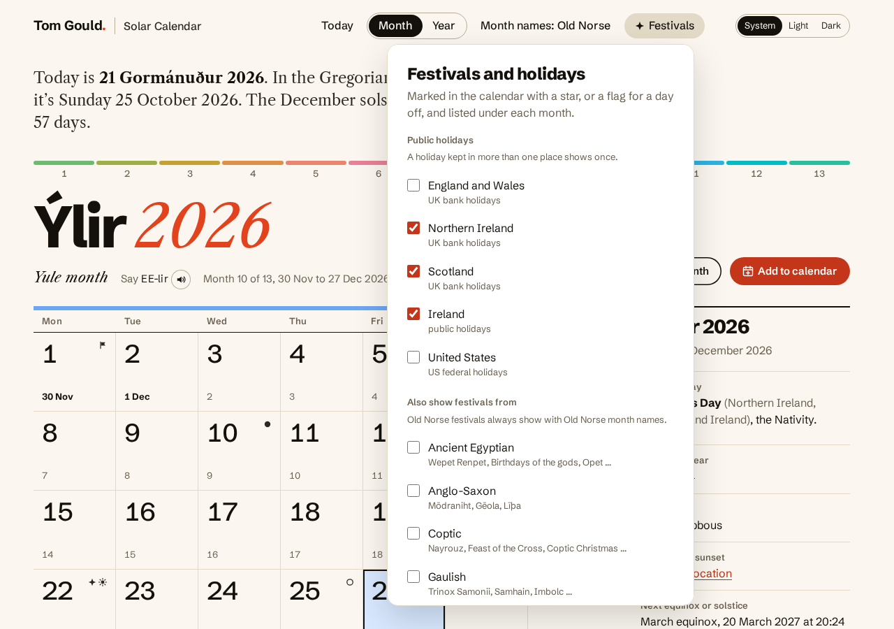
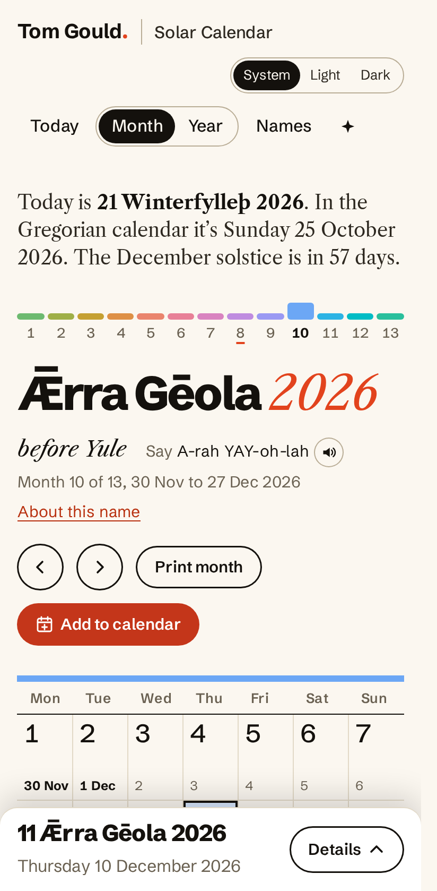
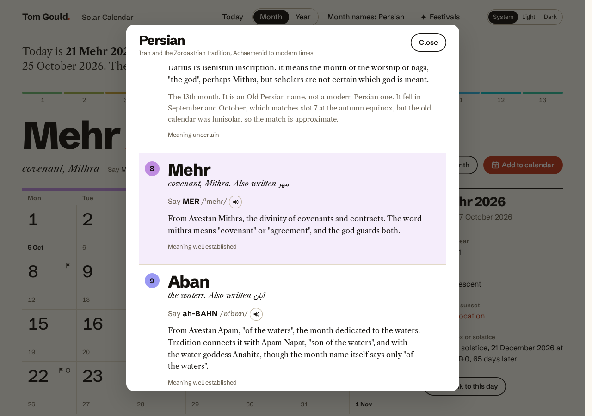

# Solar calendar

A calendar of 13 identical months. Every month has 28 days, exactly four weeks, so the 1st is always a Monday and the 28th is always a Sunday. The year starts on the first Monday on or after the March equinox, so it stays with the seasons. Gregorian dates are shown alongside every day.

**Try it: [solar.dealmobile.co.uk](https://solar.dealmobile.co.uk)**

[](https://solar.dealmobile.co.uk)

<picture><source media="(prefers-color-scheme: dark)" srcset="docs/screenshots/month-dark.png"></picture>

| Year view | Choosing festivals and holidays |
|---|---|
| <picture><source media="(prefers-color-scheme: dark)" srcset="docs/screenshots/year-dark.png"></picture> | <picture><source media="(prefers-color-scheme: dark)" srcset="docs/screenshots/festivals-dark.png"></picture> |

| On a phone | What a name means |
|---|---|
| <picture><source media="(prefers-color-scheme: dark)" srcset="docs/screenshots/phone-dark.png"></picture> | <picture><source media="(prefers-color-scheme: dark)" srcset="docs/screenshots/names-dark.png"></picture> |

The screenshots follow your light or dark setting.

## How the calendar works

- 13 x 28 = 364 days. Usually the next year starts 364 days later. About one year in six it starts 371 days later, and the extra seven days form a leap week at the end of the year.
- The equinox is calculated, not looked up. It uses Jean Meeus's algorithm (*Astronomical Algorithms*, chapter 27), accurate to about a minute. The start of the year uses the equinox's date in UTC, so the calendar is the same everywhere.
- Solar year 2026 runs from Monday 23 March 2026 to Sunday 21 March 2027. Solar 2028 ends with a leap week, 19 to 25 March 2029.

## What it does

- Opens on today, with the date in both calendars and how long until the next equinox or solstice.
- Month view: the numbers 1 to 28 never move, and only the Gregorian dates change from month to month. Equinoxes, solstices, and new and full moons are marked.
- Day details: day of the year, moon phase, and the next equinox or solstice in your local time.
- Year view: every day of the year in one table, one row per day of the month.
- Printing: a month or the whole year, each on a single A4 page, in light colours whatever the screen theme.
- Month name packs: twelve sets of month names to switch between, and read what each name means:
  - from history: Gregorian, Anglo-Saxon (recorded by Bede), Old Norse, Roman, Gaulish, Persian, ancient Egyptian and Coptic
  - modern inventions: Nature for each hemisphere, Latin numbers and Sky
- Pronunciation: a respelling and IPA for every name that isn't English, and a button that reads it aloud.
- Festivals: the historical packs (apart from Gregorian) mark their own festivals, such as Nowruz or Þorrablót, and Sky marks the meteor showers. Every pack's festivals show at once by default, listed under each month and year, and each pack can be turned off.
- Public holidays: UK bank holidays and Easter for England and Wales, Scotland and Northern Ireland, Ireland's public holidays and US federal holidays. All are on by default and each can be turned off. A weekly check keeps them in step with GOV.UK, OPM and Nager.Date.
- Go to a date: type a date in either calendar to find it in the other.
- Sunrise, sunset and hours of daylight for your location, in its own time zone. A first-visit notice explains why it asks, with a "No thanks"; the location stays in your browser.
- Add to calendar, from the month or year view: one button subscribes Google Calendar, another opens Apple Calendar or Outlook, and the feed stays up to date. Or download a single year as an .ics file.
- A badge with today's solar date for your own page or README, like the one above: `https://solar.dealmobile.co.uk/today.svg`. Add `?names=anglo-saxon` for other month names, and `&tz=Europe/London` for the date in your time zone rather than UTC.
- Works offline after the first visit, and can be installed as an app.
- No cookies or accounts: choices and your location stay in your browser. See the [privacy policy](https://solar.dealmobile.co.uk/privacy), [terms of use](https://solar.dealmobile.co.uk/terms) and [disclaimer](https://solar.dealmobile.co.uk/disclaimer).
- Light and dark themes (or follow the system), keyboard navigation, and a phone layout that keeps the selected day in a sheet along the bottom.
- Styled with the design kit shared by the apps on [www.dealmobile.co.uk](https://www.dealmobile.co.uk/projects/solar-calendar): Schibsted Grotesk and Libre Caslon, self-hosted.

## Development

```bash
npm install
npx playwright install   # browsers for the end-to-end tests
npm run dev              # http://localhost:5173
npm test                 # unit tests, then end-to-end tests
npm run typecheck
npm run build            # static site in dist/, plus the feed Worker in dist-worker/
npm run holidays:check   # fetch the official holiday lists and check the rules still match
```

Run one test file with `npx vitest run tests/unit/core.test.ts` or `npx playwright test --project=chromium`.

## Deployment

The site runs on Cloudflare Workers as static files (`wrangler.jsonc`).
- Deploying: log in once with `npx wrangler login`, then `npm run deploy` builds and deploys.
- Security headers: `public/_headers` sets them, including a strict Content-Security-Policy, so the app uses no inline styles, and no inline scripts apart from the one that applies the theme before the first paint. The build adds that script's hash to the policy.
- CI: GitHub Actions runs the type check and all tests on every push and pull request.

## Adding a month name pack

Add one JSON file to `src/names/packs/`, starting from `_template.json`. The app finds it automatically. See [docs/name-packs.md](docs/name-packs.md) for the format and writing standard. `npm run test:unit` checks every pack, including that the fonts have every letter it uses.

## Project layout

- `src/core/`: date logic with no DOM. It uses integer day numbers (`days.ts`), equinoxes and solstices (`astro.ts`) and the calendar rules (`solar.ts`).
- `src/names/`: the name pack format, its loader, and the packs.
- `src/sky/`: moon phases, using astronomy-engine, which loads only when needed.
- `src/ui/`: the month view, year view, day panel and name pack menus.
- `tests/unit/` and `tests/e2e/`: Vitest and Playwright.
- `docs/redesign.md`: the review of the original app, the decisions behind this version, and the plan.

## Licence

GNU GPL v3. See [LICENSE](LICENSE).
